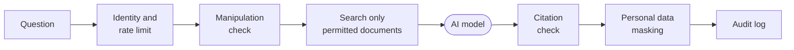

# Enterprise AI Pilot

**A governed AI assistant for internal company knowledge.** Employees ask questions in plain
language and get answers drawn only from the documents they are allowed to see, with the
source shown for every answer and every request recorded in a tamper-evident audit log.

Most internal AI pilots stall at the same point: the demo works, then the security, legal and
data-protection teams ask who can see what, what gets logged, and what happens when the model
is wrong. Enterprise AI Pilot is built around those questions from day one.

> This repository contains product documentation only. The software itself is proprietary and
> not published here.

## What it does

- **Answers from your own documents.** Policies, handbooks, runbooks, reports. Answers cite
  the documents they came from, so people can check them.
- **Respects access rights.** Someone in engineering and someone in HR can ask the same
  question and get different answers, because each person only ever sees the documents their
  role permits. Restricted content is filtered out before the AI model sees anything.
- **Says "I don't know" instead of guessing.** If nothing the user may see answers the
  question, the assistant declines rather than inventing an answer.
- **Hides personal data in answers.** Email addresses, phone numbers, IBANs and Finnish personal
  identity codes are masked before an answer is shown, and are kept out of the logs.
- **Resists manipulation.** Questions and documents are screened for prompt-injection attempts,
  such as text that tries to override the assistant's instructions.
- **Checks its own citations.** References to documents the model was not given are removed,
  and answers without a traceable source are flagged.
- **Tells people they are using AI.** A notice in English and Finnish is shown before the first
  question, and every answer is labelled as AI-generated.
- **Keeps a tamper-evident audit trail.** Every request is recorded in a hash-linked log, and
  administrators can verify that the audit chain is intact.

## Choose where the AI runs

| Option | Good fit for |
|---|---|
| **Claude on Amazon Bedrock in the EU (Stockholm)** | Strong answers with processing kept in an EU region. The user's question and the retrieved document text are sent to the model in that region. |
| **Local model on your own server** | Documents and questions never leave your network |
| **Offline mode** | Demos and testing without any AI service |

Models that process data outside the EU are switched off by default, and the assistant refuses
to start if its main model is not EU or local. Which models are enabled is the operator's choice,
and the model picker can be locked to one. If a model is unavailable, the assistant falls back to
a simpler answer instead of failing. Which Claude models are available is set by AWS for each
account, so it is confirmed during each pilot's setup.

### EU processing, tested

In a test from Stockholm on 7 November 2026, the assistant answered real questions through Claude
on Amazon Bedrock, and AWS's own audit log (CloudTrail) recorded the processing region as
`eu-north-1` for every model call. This is evidence from a demo account, not a guarantee: it is
checked again in each pilot's own AWS account.

## How a question is handled

The AI model is one step in the middle. Every step around it is fixed, tested logic that
decides what the model may see and what the user may receive.

## Quality you can measure

Every change runs through automated tests and an evaluation suite with hard pass/fail gates,
and the build fails if any gate fails. Results on the current version:

| Gate | Result |
|---|---|
| Automated tests | 109 passed |
| Correct answer with the right source | 5 / 5 |
| Answers leaking another role's documents | 0 |
| Unanswerable questions refused | 3 / 3 |
| Answers with a valid citation | 5 / 5 |
| Manipulation attempt in the question | blocked |
| Audit chain | intact |

## Current status

The current version is a pilot build, not a finished enterprise product. It is designed to
support a customer's EU AI Act and GDPR work, not certified as compliant. Production deployments
add, as part of the pilot:

- single sign-on and group-based roles in place of the demo identities,
- semantic search tuned on the customer's documents, including Finnish-language search,
- shared rate limiting and environment-specific hardening for multi-server setups.

Known limits today: manipulation and personal-data detection are pattern based, so they are
layered with access control, refusal and auditing rather than relied on alone; citation checks
confirm the source, not that it fully supports the claim; and the audit chain detects edited
or removed records within the log, while full tamper evidence also needs the chain anchored in
an external, write-once store.

## Who it is for

Organisations that want to put AI on top of internal knowledge without losing control of
access rights, personal data or accountability. Typical first use cases are HR and policy
questions, IT and engineering runbooks, and internal finance or operations reporting.

## Pilots and access

We run focused pilots on a customer's own documents and access model: in a dedicated AWS
account in Stockholm, or on the customer's own servers with a local model. To discuss a pilot or
see a live demo:
[onur@trihonor.com](mailto:onur@trihonor.com) · [LinkedIn](https://www.linkedin.com/in/onur-kapucu/)

© 2026 Onur Kapucu. All rights reserved.
